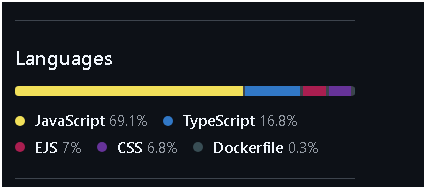

<div align="center">
  

# SpotSync

**Discover, share, and review the best camping spots — powered by AI**

[](https://www.typescriptlang.org/)
[](https://nodejs.org/)
[](https://expressjs.com/)
[](https://mongodb.com/)
[](src/__tests__)
[](public/manifest.json)
[](LICENSE)

[🌍 Live Demo](#deployment) · [🐛 Report Bug](https://github.com/mayankcodes-dev/spotsync/issues) · [✨ Request Feature](https://github.com/mayankcodes-dev/spotsync/issues)

</div>

---

## 📸 Overview

SpotSync is a full-stack **MVC web application** for discovering and sharing camping spots. Upload photos, drop a pin on the map, write reviews — and let our **AI image moderation** keep the community safe automatically.

Built with a **100% TypeScript** codebase (server + client + seeds + scripts), EJS + Bootstrap views, and a Node/Express backend backed by MongoDB Atlas.

---

## 🤖 How We Use AI

SpotSync integrates **Google Gemini AI** for automatic image moderation on every spot listing:

### Image Moderation Pipeline

```
User uploads photo(s)
        ↓
  Multer handles multipart upload (max 10 MB / 5 files)
        ↓
  Cloudinary stores the image → returns a URL
        ↓
  Gemini Vision API (gemini-1.5-flash) analyses the image
        ↓
  ┌─── SAFE ──────────────────────────────────────────┐
  │   Spot is created / updated normally              │
  └───────────────────────────────────────────────────┘
  ┌─── UNSAFE ────────────────────────────────────────┐
  │   Image is deleted from Cloudinary automatically  │
  │   Flash error shown to user                       │
  │   Spot creation / update is blocked               │
  └───────────────────────────────────────────────────┘
```

**What it detects:** Violence, adult content, hate symbols, graphic content, and other policy violations — using a structured prompt that asks Gemini to return a JSON verdict `{ isSafe: boolean, reason: string }`.

**Where it runs:** [`src/services/geminiModeration.ts`](src/services/geminiModeration.ts) — called from both `createCampground` and `updateCampground` in [`src/controllers/campgrounds.ts`](src/controllers/campgrounds.ts).

**Why Gemini:** Multimodal understanding, free tier generous enough for a hobby project, and the `@google/generative-ai` SDK is well-typed for TypeScript.

### Rate Limiting (Upstash Redis AI-adjacent)

[Upstash Redis](https://upstash.com/) with `@upstash/ratelimit` provides sliding-window rate limiting on:
- `POST /spots` — 3 spot creations per 15 minutes per IP
- `POST /login` — 10 attempts per 15 minutes per IP
- `POST /register` — 5 registrations per hour per IP

---

## ✨ Features

| Category | Feature |
|----------|---------|
| 🗺️ **Maps** | Interactive cluster map (all spots) + satellite 3D terrain map (spot detail) via MapTiler SDK |
| 📸 **Photos** | Multi-image upload to Cloudinary (max 5 images, 10 MB each) |
| 🤖 **AI Moderation** | Gemini Vision auto-reviews every uploaded image |
| ⭐ **Reviews** | Star ratings + text reviews with author-only delete |
| 🔐 **Auth** | Passport.js local strategy, bcrypt passwords, session-based auth |
| 🛡️ **Security** | CSRF protection (csrf-csrf), Helmet CSP, rate limiting, mongo-sanitize, secure session cookies |
| 📱 **PWA** | Installable on iOS / Android / Desktop, offline cache via Service Worker |
| ♿ **A11y** | Semantic HTML, form labels, ARIA attributes, keyboard navigation |

---

## 🏗️ Architecture (MVC)

```
SpotSync/
├── src/                        # Backend TypeScript (compiled → dist/)
│   ├── app.ts                  # Express app setup, middleware, routes
│   ├── controllers/            # Route handlers (campgrounds, reviews, users)
│   ├── models/                 # Mongoose models (Campground, Review, User)
│   ├── routes/                 # Express routers
│   ├── middleware/             # isLoggedIn, isAuthor, validateCampground, rateLimit
│   ├── services/
│   │   ├── geminiModeration.ts # 🤖 AI image moderation
│   │   └── redis.ts            # Upstash Redis cache + rate limit
│   ├── utils/                  # ExpressError, catchAsync, mongoSanitize
│   ├── schemas.ts              # Joi validation schemas
│   └── __tests__/              # Jest unit + integration tests
│
├── views/                      # EJS templates (rendered server-side)
│   ├── layouts/boilerplate.ejs # Main HTML shell
│   ├── partials/               # navbar, footer, flash
│   ├── campgrounds/            # index, show, new, edit
│   └── users/                  # login, register
│
├── public/                     # Static assets served directly
│   ├── images/                 # logo.png, placeholder.svg
│   ├── favicon.png             # App favicon (your logo)
│   ├── javascripts/            # Compiled client-side JS (from client/)
│   ├── stylesheets/            # CSS
│   ├── icons/                  # PWA icons
│   ├── manifest.json           # PWA manifest
│   └── sw.js                   # Service Worker (compiled from client-sw/)
│
├── client/                     # Client-side TypeScript source
│   ├── clusterMap.ts           # MapTiler cluster map
│   ├── showPageMap.ts          # MapTiler spot-detail map
│   ├── validateForms.ts        # Bootstrap form validation
│   └── pwa.ts                  # PWA install + Service Worker registration
│
├── client-sw/
│   └── sw.ts                   # Service Worker TypeScript source
│
├── seeds/                      # DB seeder (TypeScript)
│   ├── index.ts                # Run: npm run seed
│   ├── seedHelpers.ts          # Place/descriptor word lists
│   └── cities.js               # US cities dataset (raw data)
│
├── scripts/
│   └── generateIcons.ts        # PWA icon generator: npm run generate:icons
│
├── tsconfig.json               # Server TS config (strict: true)
├── tsconfig.client.json        # Client TS config → public/javascripts/
├── tsconfig.sw.json            # Service Worker TS config → public/sw.js
├── Dockerfile                  # Multi-stage production build
└── Jenkinsfile                 # CI/CD pipeline
```

---

## 🚀 Quick Start

### Prerequisites

- Node.js ≥ 18
- MongoDB (local or Atlas URI)
- Cloudinary account
- MapTiler API key
- Google AI Studio key (Gemini)
- Upstash Redis (optional — rate limiting degrades gracefully)

### 1. Clone & install

```bash
git clone https://github.com/mayankcodes-dev/spotsync.git
cd spotsync
npm install
```

### 2. Environment variables

Create `.env` in the project root:

```env
# Database
DB_URL=mongodb+srv://<user>:<pass>@cluster0.xxx.mongodb.net/spotsync

# Session / CSRF secret — use a long random string in production
SECRET=your-super-secret-32-char-min

# Cloudinary
CLOUDINARY_CLOUD_NAME=your_cloud_name
CLOUDINARY_KEY=your_api_key
CLOUDINARY_SECRET=your_api_secret

# MapTiler
MAPTILER_API_KEY=your_maptiler_key

# Google Gemini (AI moderation)
GEMINI_API_KEY=your_gemini_api_key

# Upstash Redis (optional — rate limiting)
UPSTASH_REDIS_REST_URL=https://...upstash.io
UPSTASH_REDIS_REST_TOKEN=your_token

# Seeder (optional)
SEED_USER_ID=your_mongodb_user_objectid
```

### 3. Run locally

```bash
# Development (ts-node, hot not included — use dev:watch for nodemon)
npm run dev

# Or with auto-reload:
npm run dev:watch

# Seed sample data:
npm run seed
```

Visit `http://localhost:3000`

### 4. Build for production

```bash
npm run build        # Compiles server + client + service worker TypeScript
npm run start:prod   # NODE_ENV=production node dist/app.js
```

---

## 🧪 Tests

```bash
npm test              # Run all tests (jest --forceExit)
npm run test:coverage # With coverage report
```

```
Test Suites: 4 passed, 4 total
Tests:       24 passed, 24 total
```

**Covered:**
- `geminiModeration.ts` — mock Gemini API, safe/unsafe/error paths
- `campgrounds` controller — create, update, delete with auth mocks
- `users` controller — login, register, logout flows  
- `campgrounds` routes — integration tests with supertest

---

## 🐳 Docker

```bash
# Build image
docker build -t spotsync .

# Run (pass env vars)
docker run -p 3000:3000 \
  -e DB_URL=... \
  -e SECRET=... \
  -e CLOUDINARY_CLOUD_NAME=... \
  -e CLOUDINARY_KEY=... \
  -e CLOUDINARY_SECRET=... \
  -e MAPTILER_API_KEY=... \
  -e GEMINI_API_KEY=... \
  spotsync
```

---

## ☁️ Deployment

### Oracle Cloud Always Free (Recommended — no cold starts)

Oracle Cloud's **Always Free** tier gives you a real VM that **never sleeps**, unlike Render's free tier:

1. Create an Oracle Cloud account → **Compute → Instances → Create**
2. Pick **VM.Standard.E2.1.Micro** (Always Free eligible, 1 OCPU / 1 GB RAM)
3. Choose **Ubuntu 22.04** image
4. SSH in and install Node.js 22 + PM2:
   ```bash
   curl -fsSL https://deb.nodesource.com/setup_22.x | sudo -E bash -
   sudo apt-get install -y nodejs
   sudo npm install -g pm2
   ```
5. Clone repo, copy `.env`, then:
   ```bash
   npm install && npm run build
   pm2 start dist/app.js --name spotsync
   pm2 startup && pm2 save
   ```
6. Open port 3000 in Oracle's VCN Security List → done!

### Alternatives

| Platform | Free Tier | Cold Starts | Notes |
|----------|-----------|-------------|-------|
| **Oracle Cloud** | Always Free VM | ❌ None | Best option |
| **Fly.io** | 3 shared VMs | ❌ None | `fly launch` + `fly deploy` |
| **Koyeb** | 1 nano service | ❌ None | Docker deploy |
| **Render** | 750 hrs/month | ✅ Yes (15s) | Avoid for production |

---

## 🔒 Security Highlights

- **CSRF**: Every state-mutating form is protected with `csrf-csrf` double-submit tokens
- **Helmet CSP**: Strict Content-Security-Policy with allow-listed external hosts
- **Session**: `httpOnly`, `secure` (production), `sameSite: lax`, encrypted MongoDB store
- **Rate limiting**: Upstash sliding-window limits on auth and creation routes
- **Input sanitisation**: Joi schema validation + `express-mongo-sanitize` on all POST bodies
- **Uploads**: Multer limits (10 MB/file, 5 files max) + Gemini AI content moderation
- **Auth**: Passport.js + `passport-local-mongoose` (bcrypt)

---

## 🛠️ Tech Stack

| Layer | Technology |
|-------|-----------|
| **Runtime** | Node.js 22 |
| **Language** | TypeScript 5 (strict, 100% — server, client, seeds, scripts) |
| **Framework** | Express 5 |
| **Views** | EJS + ejs-mate + Bootstrap 5 |
| **Database** | MongoDB + Mongoose 8 |
| **Auth** | Passport.js + passport-local-mongoose |
| **Storage** | Cloudinary (images) |
| **Maps** | MapTiler SDK |
| **AI** | Google Gemini Vision (image moderation) |
| **Cache / Rate limit** | Upstash Redis |
| **PWA** | Service Worker + Web App Manifest |
| **Security** | Helmet, csrf-csrf, express-mongo-sanitize |
| **Testing** | Jest + Supertest + ts-jest |
| **CI/CD** | Jenkins (Jenkinsfile) |
| **Container** | Docker (multi-stage) |

---

## 🤝 Contributing

1. Fork the repo
2. Create a feature branch: `git checkout -b feat/amazing-feature`
3. Commit your changes: `git commit -m 'feat: add amazing feature'`
4. Push: `git push origin feat/amazing-feature`
5. Open a Pull Request

**Code rules:**
- All files must be `.ts` — no raw `.js` in `src/`, `client/`, `client-sw/`, `scripts/`, or `seeds/`
- `npm run lint` must pass (zero TypeScript errors across all three tsconfigs)
- `npm test` must show 24/24 passing before any PR merge

---

## 📄 License

ISC © [Mayank](https://github.com/mayankcodes-dev)
